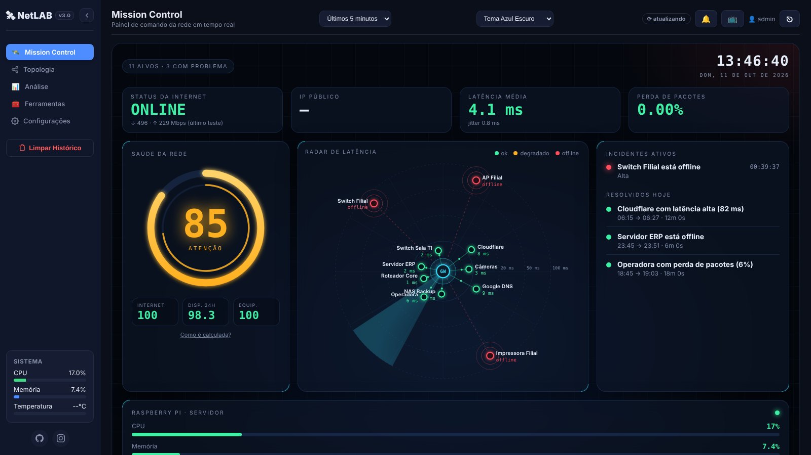
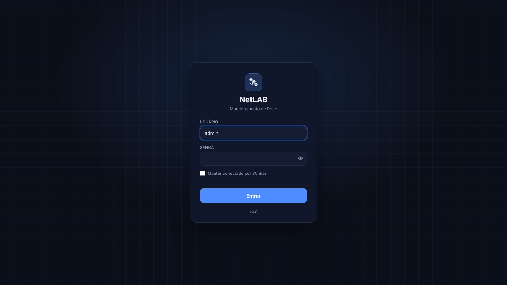
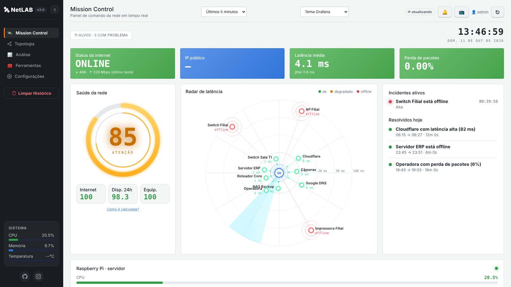
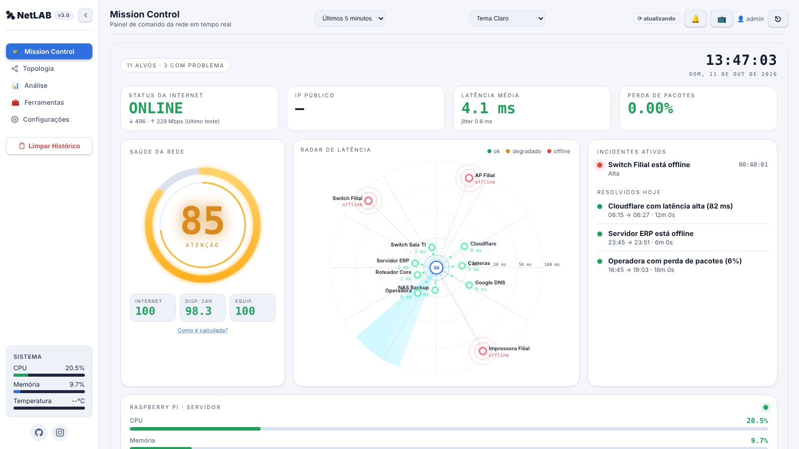
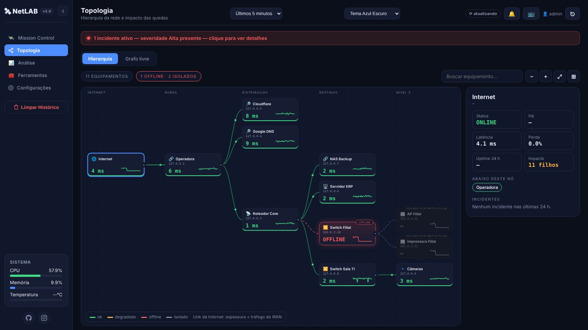
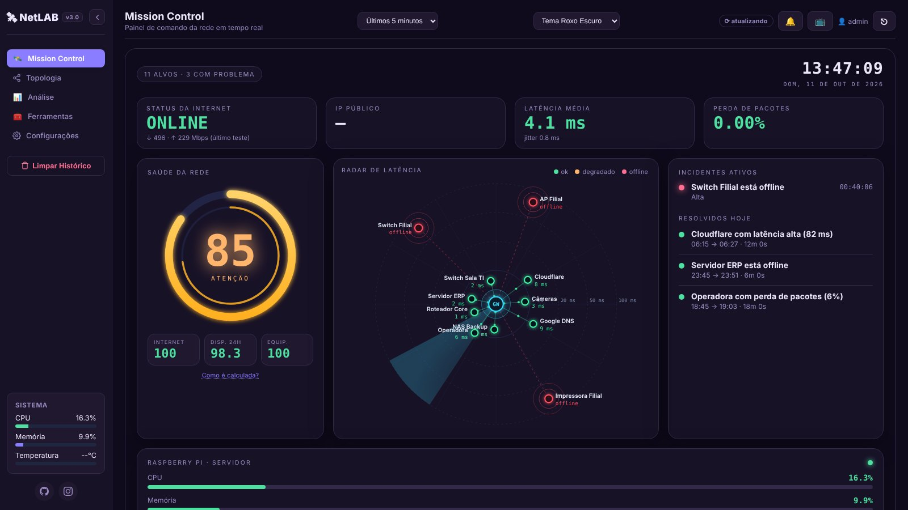
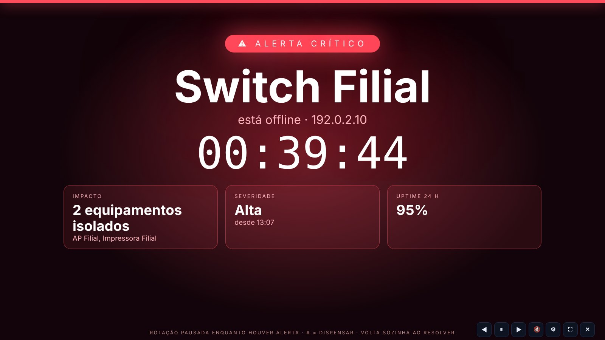

# 🛰️ NetLAB

Dashboard de monitoramento de rede em tempo real, feito para rodar em um Raspberry Pi (ou qualquer Linux) com baixo consumo de CPU/RAM. Interface no estilo de ferramentas de NOC, 100% self-hosted, sem depender de serviços externos além dos alvos que você monitora.




---

## 🖼️ Capturas de tela

> Dados de demonstração.

| | |
|---|---|
| <br>**Tela de login** com nome do app e tema | <br>**Mission Control** (tema Azul Escuro) |
| <br>**Tema Grafana** | <br>**Tema Claro** |
| <br>**Topologia em árvore**: impacto das quedas ("isolado por…") | <br>**Tema Roxo Escuro** |
| <br>**Modo TV: alerta** que toma a tela | <br>**Modo TV: visão geral** |
| <br>**Modo TV: topologia** | <br>**Modo TV: últimas 24 h** |

---

## ✨ Funcionalidades

**Monitoramento**
- Ping em tempo real (latência, jitter e perda) com atualização ao vivo via SSE
- Checks ICMP, **TCP** e **HTTP/HTTPS** (com código esperado e validade do certificado)
- Uptime 24 h, barras de disponibilidade e sparklines por alvo
- Alvo pai/filho: o filho não alerta quando o pai está offline
- Comparação de DNS, teste de velocidade, CPU/memória/temperatura do host
- Integração com **MikroTik** (RouterOS v7), **AdGuard Home**, **SNMP v1/v2c/v3** (inclui OIDs customizados, ex.: potência óptica de OLT) e **Zabbix**
- **Multi-site**: agente leve para filiais, com diagnóstico "problema no alvo × na conexão do central"

**Incidentes e alertas**
- Incidentes automáticos (offline, latência, jitter, perda, CPU/temperatura, certificado) com histerese
- Notificações por Telegram, Discord, webhook assinado (HMAC), e-mail SMTP e notificações do navegador
- Janelas de manutenção (registra o incidente sem notificar)

**Análise e relatórios**
- Timeline de incidentes, heatmap dia × hora e detecção de padrões
- SLA, MTTR e MTBF por alvo, exportação CSV e relatório imprimível (`/report.html`)
- Página pública de status (`/status`) opcional
- Métricas Prometheus em `/metrics`
- Backup e restauração (sem segredos)

**Ferramentas**
- Traceroute, comparação IPv4 × IPv6 e descoberta de dispositivos na rede (ICMP + ARP + DNS reverso)

**Interface**
- **Mission Control**: painel principal com saúde da rede, radar de latência, incidentes, equipamentos, speedtest, sites e AdGuard
- **Modo TV** (botão 📺 ou `#tv`): 4 cenas em rodízio (visão geral, topologia, equipamentos, 24 h), tela de alerta que toma o monitor, som e toasts
- **Topologia em árvore** (hierarquia com impacto das quedas, "isolado por X") e grafo livre, com tráfego dos links em tempo real
- 7 temas (Azul, Verde, Roxo, OLED, Claro, **Grafana** e Personalizado) que valem em toda a interface, inclusive Mission Control, TV e login
- Menu lateral recolhível, layout responsivo e PWA instalável
- Nome da aplicação configurável (aparece em menu, login, TV, alertas, relatórios e app instalado)

**Segurança**
- **Tela de login própria** (sessão por cookie HttpOnly/SameSite, "manter conectado", botão Sair), perfis `admin` e `viewer`, proteção CSRF, CSP e limite de tentativas
- Basic Auth continua disponível para scripts/curl; `/metrics` com token Bearer
- Senhas e tokens cifrados no banco (Fernet), validação de entradas, log de auditoria

---

## 🧰 Requisitos

- Python 3.9 ou superior
- Linux (testado em Raspberry Pi OS / DietPi e Debian/Ubuntu)
- Pacotes opcionais: `snmp` (SNMP), `traceroute` e `iputils-ping`

---

## 🚀 Instalação

> 📘 **Tutorial completo passo a passo (serviço, HTTPS, backup, problemas comuns): [INSTALL.md](INSTALL.md)**

```bash
git clone https://github.com/ebertonjs/netlab.git
cd netlab
chmod +x install.sh
./install.sh
```

O `install.sh` instala `gcc`/`python3-dev` (se faltarem), as ferramentas `snmp`, `traceroute` e `iputils-ping`, cria o ambiente virtual `venv` e instala o `requirements.txt`.

### Instalação manual

```bash
sudo apt-get update
sudo apt-get install -y gcc python3-dev python3-venv snmp traceroute iputils-ping

python3 -m venv venv
source venv/bin/activate
pip install -r requirements.txt
```

---

## ▶️ Rodando

```bash
source venv/bin/activate
python3 -m uvicorn main:app --host 0.0.0.0 --port 8000
```

Acesse `http://IP_DO_DISPOSITIVO:8000` (descubra o IP com `hostname -I`) e entre pela tela de login.

### Primeiro acesso

Na primeira subida o terminal mostra a senha do usuário `admin`:

```
NetNOC: usuário inicial 'admin'  senha: xxxxxxxxxxxx
```

- Para escolher a senha antes de subir: `export NETNOC_ADMIN_PASSWORD='sua-senha'`
- Para trocar depois: `python manage.py set-password admin`
- Para redefinir se esqueceu: `python manage.py reset-admin` (gera uma senha nova)
- Para criar usuários só de leitura: **Configurações → Segurança**

### Rodar como serviço (systemd)

Atalho: `./install.sh --service` cria e ativa o serviço sozinho. Manualmente:

Crie `/etc/systemd/system/netnoc.service` ajustando usuário e caminhos:

```ini
[Unit]
Description=NetNOC
After=network-online.target
Wants=network-online.target

[Service]
User=seu_usuario
WorkingDirectory=/home/seu_usuario/netlab
Environment=PYTHONUNBUFFERED=1
ExecStart=/home/seu_usuario/netlab/venv/bin/python -m uvicorn main:app --host 0.0.0.0 --port 8000
Restart=always

[Install]
WantedBy=multi-user.target
```

```bash
sudo systemctl daemon-reload
sudo systemctl enable --now netnoc
sudo journalctl -u netnoc -f     # logs (a senha inicial do admin aparece aqui)
```

---

## ⚙️ Configuração

Quase tudo é feito pela interface, em **Configurações**: destinos e tipos de check, servidores DNS, intervalos, notificações, manutenção, SNMP, Zabbix, MikroTik, AdGuard, usuários, tokens, backup e página pública. O `config.json` traz apenas os valores iniciais.

| Variável | Para que serve |
|---|---|
| `NETNOC_ADMIN_PASSWORD` | Senha inicial do `admin` |
| `NETNOC_DB` | Caminho do banco SQLite (padrão `netnoc.db`) |
| `NETNOC_KEY_FILE` | Arquivo da chave de cifragem (padrão `netnoc.key`) |
| `NETNOC_SECRET_KEY` | Chave de cifragem direto na variável (alternativa ao arquivo) |
| `NETNOC_AUTH=off` | Desliga o login (não recomendado) |

> ⚠️ Faça backup do `netnoc.db` **e** do `netnoc.key`. Sem a chave, as senhas e tokens salvos não podem ser lidos.

### Agente para sites remotos

1. Gere o token em **Configurações → Segurança**.
2. Em cada alvo, informe o site (ex.: `filial-a`).
3. No site remoto: `python3 agent.py --url https://noc.exemplo:8000 --site filial-a --token TOKEN`

### Prometheus

`GET /metrics` com Basic ou `Authorization: Bearer <token>` (o token é gerado na interface).

---

## 🔄 Atualizando

```bash
cd netlab
git pull
source venv/bin/activate
pip install -r requirements.txt
sudo systemctl restart netnoc
```

O banco é migrado automaticamente na primeira subida. Faça backup antes.

---

---

## 🗂️ Estrutura

```
main.py            API (FastAPI) e rotas
monitor.py         coleta, incidentes, notificações, integrações
security.py        login, cifragem, validações
db.py / stats.py   SQLite (WAL), rollups e consultas
checks.py          checks ICMP/TCP/HTTP e certificados
snmp.py zabbix.py  integrações
sla.py backup.py   relatórios e backup
agent.py           agente para sites remotos
manage.py          administração de usuários/senhas
notifier.py        canais de notificação (Telegram, Discord, webhook, e-mail)
sites.py           multi-site (agentes)
static/            interface (HTML, CSS e JS sem build; login.html = tela de login)
docs/              notas de cada atualização
INSTALL.md         tutorial de instalação
CHANGELOG.md       histórico de versões
```

---

## 📄 Licença

MIT — veja [LICENSE](LICENSE).
