# 🛰️ NetLAB

Painel de monitoramento de rede **self-hosted** (na interface ele se chama **NetNOC**; o nome é configurável), feito para rodar num Raspberry Pi (ou qualquer Linux) e ficar aberto num tablet na parede, numa TV ou no PC. Ping, DNS, incidentes, MikroTik, AdGuard, topologia, SLA, câmeras do DVR e modo TV — tudo num processo leve, com SQLite embutido e sem depender de serviço externo.


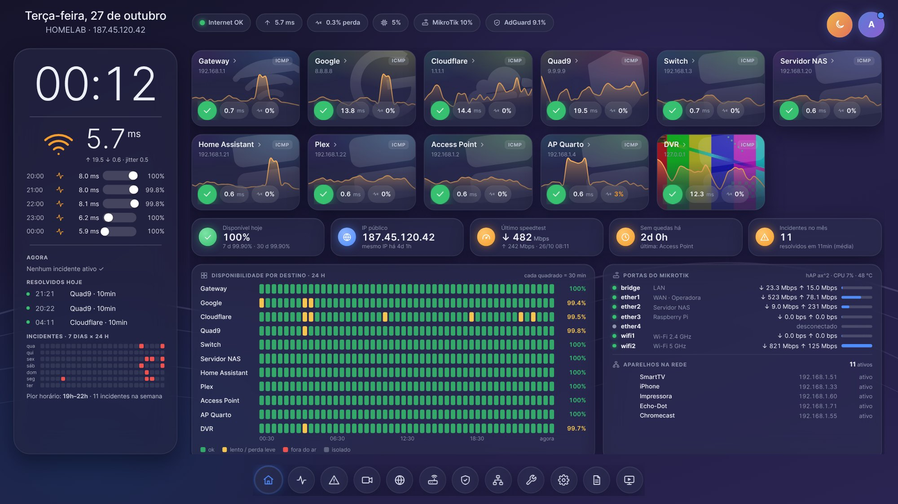

---

## ✨ Destaques

- **Ping em tempo real** por destino — latência, jitter e perda, com sparkline e disponibilidade por hora
- Checks **ICMP, TCP e HTTP/HTTPS** (código esperado e validade do certificado) e **multi-site** com agente leve para filiais
- **Incidentes automáticos** que abrem e fecham sozinhos (offline, perda, latência, jitter, DNS lento, CPU/temperatura, câmera sem vídeo, HD do DVR). Queda local vira **um único alerta** em vez de dezenas
- **Notificações** por Telegram, Discord, webhook assinado (HMAC), e-mail e navegador, com janelas de manutenção — no Telegram, a perda de vídeo chega com a **última foto da câmera**
- **4 temas que mudam a interface inteira**, escolhidos por aparelho, com tamanho ajustável (Normal / Compacta / Mínima)
- **Página inicial completa**: indicadores (disponibilidade hoje/7 d/30 d, IP público, último speedtest, tempo sem quedas), disponibilidade de cada destino em blocos de 30 min, portas do MikroTik, aparelhos novos na rede, fotos das câmeras, AdGuard, DNS e saúde do servidor
- **Mapa da rede em caixas**, estilo NOC: grupos de equipamentos ligados por linhas com pacotes animados, causa raiz em vermelho e dependentes como "isolados"
- **Modo TV** com rodízio de cenas: visão geral, mapa da rede, equipamentos, últimas 24 h e câmeras
- **Speedtest automático** diário no horário que você escolher
- **Câmeras do DVR Intelbras** (MHDX, API compatível Dahua) **ao vivo só enquanto alguém assiste** — roda até no Raspberry Pi 3
- **Integrações**: MikroTik (REST), AdGuard Home, SNMP, Zabbix, agentes remotos
- **Comparação de DNS**, speedtest, ferramentas (traceroute, portas, certificados, varredura de rede)
- **SLA**, MTTR/MTBF, heatmap dia × hora, relatório imprimível, página de status pública opcional e métricas **Prometheus**
- **Login com sessão**, perfis admin/visualizador, proteção CSRF e CSP, credenciais cifradas no banco
- **Tudo configurável pela interface**, sem editar arquivo

---

## 🏠 Página inicial

Além dos cards de cada destino, a página inicial mostra tudo o que importa sem precisar clicar. Os blocos de integrações que você não usa (MikroTik, AdGuard, DVR) simplesmente não aparecem.

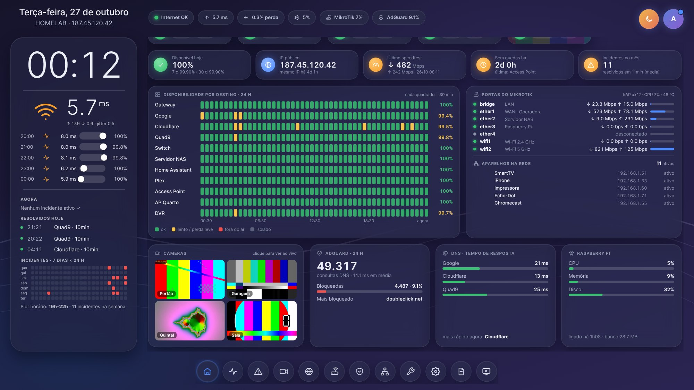

1. **Indicadores** — disponibilidade hoje / 7 d / 30 d, IP público (e há quanto tempo não muda), último speedtest, tempo sem quedas e incidentes do mês.
2. **Disponibilidade por destino** — 24 h em blocos de 30 min: ok, lento, fora do ar ou isolado.
3. **MikroTik** — cada porta com status e tráfego (o nome vem do comentário da interface) e os **aparelhos na rede**, com os novos do dia em destaque.
4. **Câmeras** — uma foto por minuto, só com a página aberta; clique para ver ao vivo.
5. **AdGuard**, **DNS** e **servidor** (CPU, memória, temperatura, disco), mais o **mapa de incidentes** 7 dias × 24 h na coluna da esquerda.

---

## 🗺️ Mapa da rede

**Topologia → Mapa**: os destinos viram caixas agrupadas, ligadas pelo "Depende de", com pacotes correndo nas linhas e a latência de cada ligação. Quando algo cai, a caixa e a ligação ficam vermelhas e quem depende dela aparece como **isolado** — a causa raiz salta aos olhos.

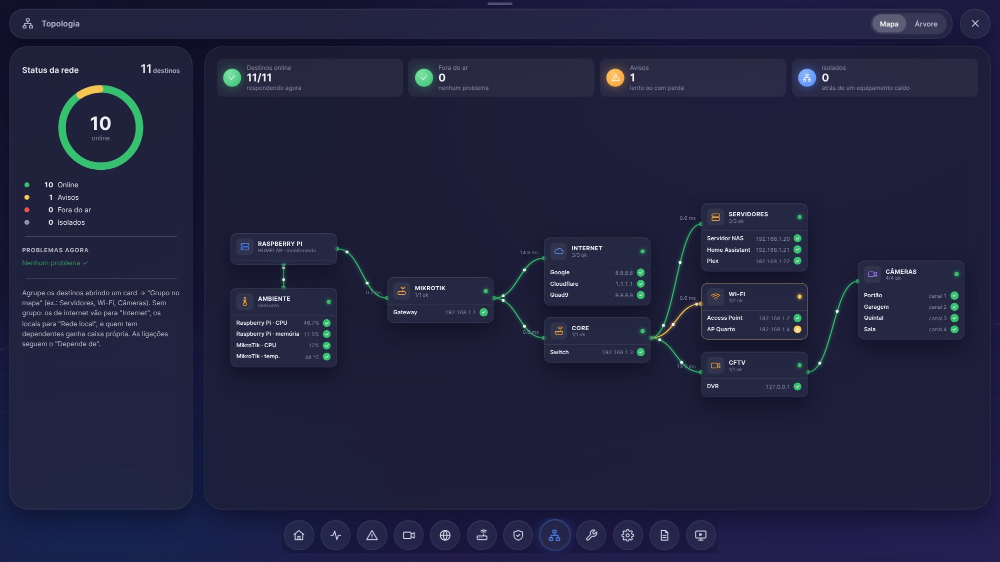

| Com um equipamento fora do ar | No Modo TV |
|---|---|
| 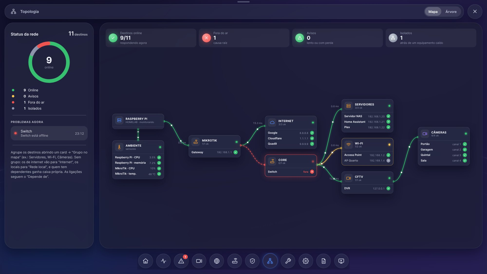 | 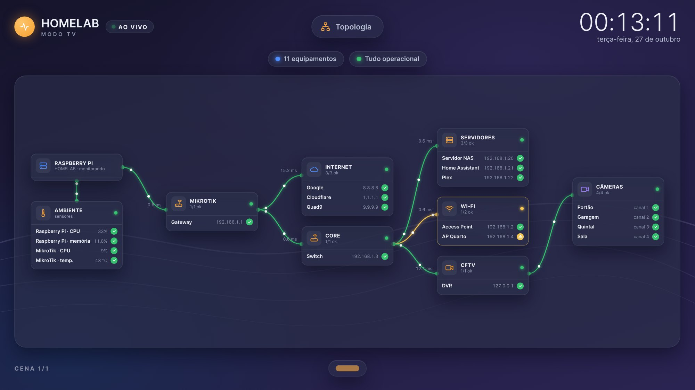 |

- **Grupos**: defina "Grupo no mapa" em cada destino (Servidores, Wi-Fi, Câmeras…). Sem grupo, o NetLAB agrupa sozinho: destinos de internet em "Internet", locais em "Rede local" e quem tem dependentes ganha caixa própria.
- Caixas extras: **Ambiente** (CPU e temperatura do servidor e do MikroTik) e **Câmeras** (canais do DVR).
- A vista antiga em árvore continua no botão **Árvore**.

---

## 🎨 Temas

Cada aparelho escolhe o seu em **Configurações → Aparência**. O admin define o padrão do servidor, e uma URL pode fixar o tema numa tela de quiosque.

| Glass (escuro / claro) | NOC Terminal |
|---|---|
| 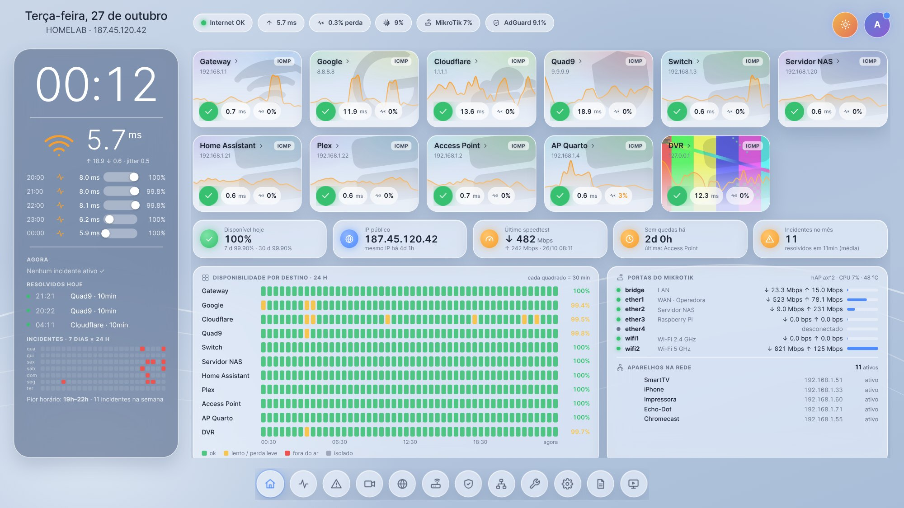 | 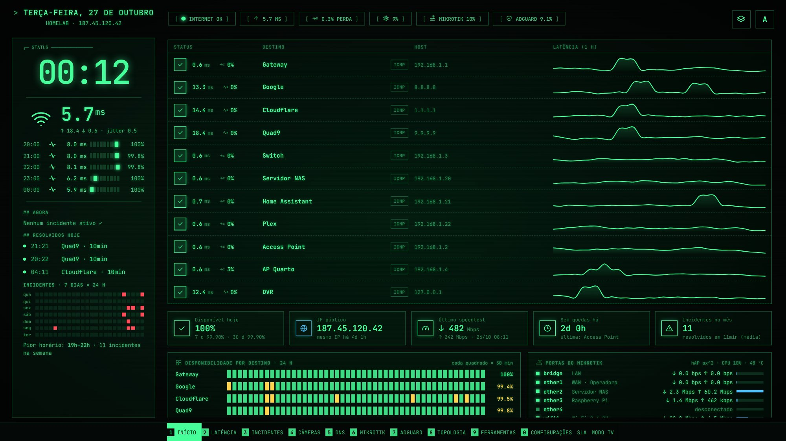 |
| **Grafana / Zabbix** | **Material You** |
| 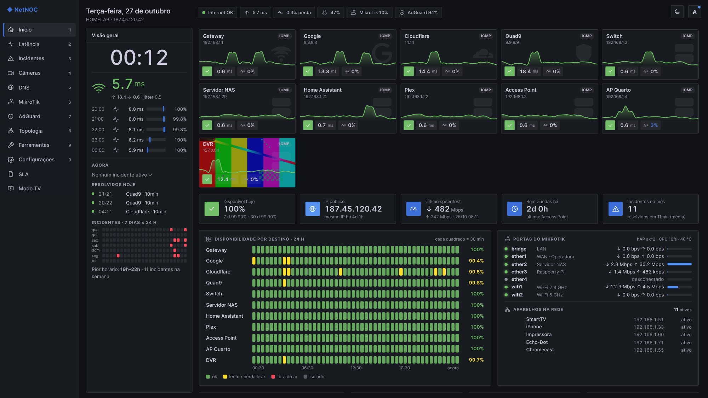 | 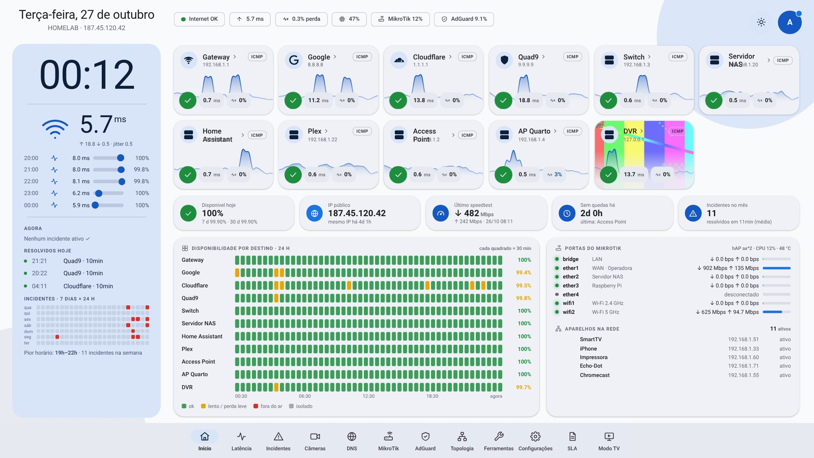 |

- **Glass** — vidro fosco, cards com imagem e dock flutuante. Feito para tablet na parede.
- **NOC Terminal** — monoespaçado, fósforo verde/âmbar/ciano, destinos em tabela, navegação pelas teclas 1–0.
- **Grafana / Zabbix** — painéis planos e densos com menu lateral fixo. Mais informação por tela no PC.
- **Material You** — paleta inteira gerada a partir da sua cor de destaque.

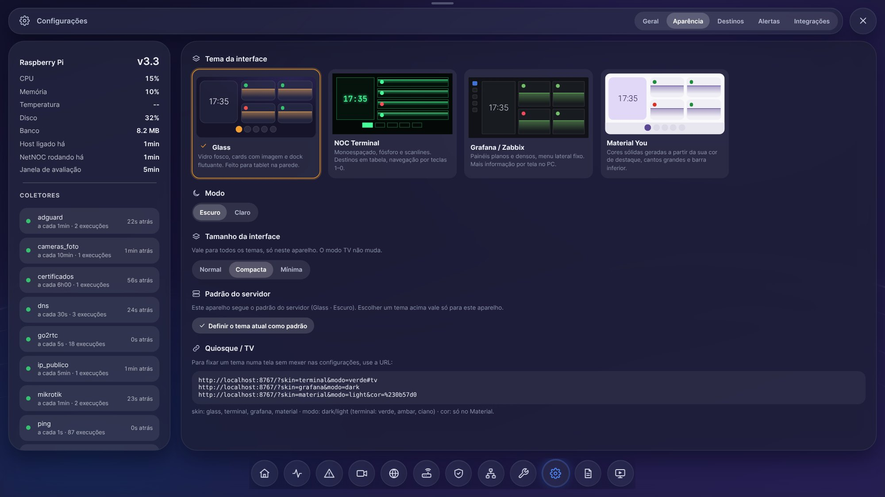

---

## 📺 Modo TV

Tela cheia, pensada para ficar ligada o dia todo: relógio grande, rodízio automático de cenas e alerta em tela cheia quando algo crítico acontece (com som opcional).

| Visão geral | Últimas 24 horas |
|---|---|
| 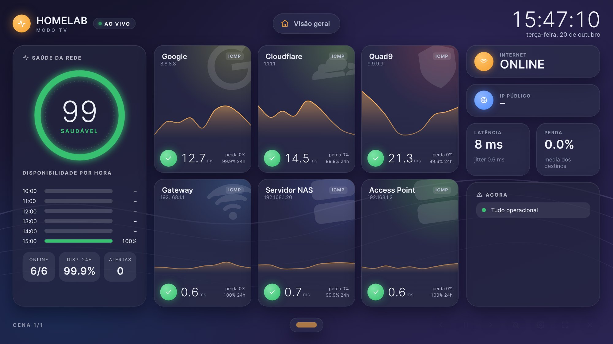 | 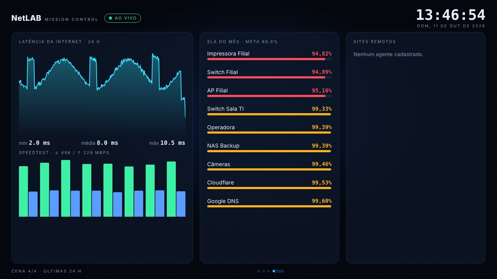 |

Atalhos: `←` `→` trocam de cena, `espaço` pausa, `A` dispensa o alerta, `S` liga/desliga o som, `F` tela cheia, `Esc` sai.
Para abrir direto numa TV: `http://IP:8000/#tv` — ou só algumas cenas: `/#tv?cenas=1,2,5&tempo=20`.

---

## 📈 Latência e celular

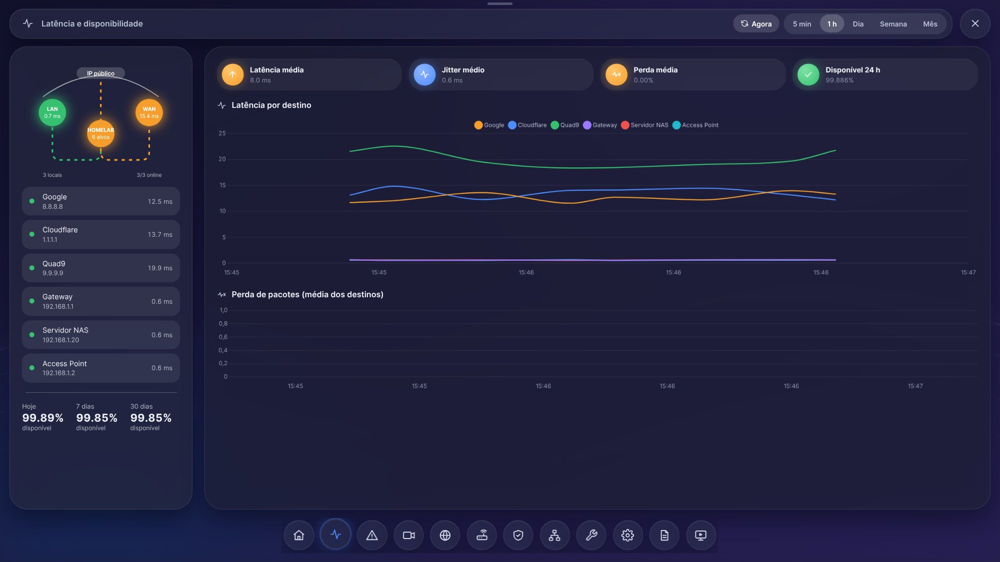

<p align="center">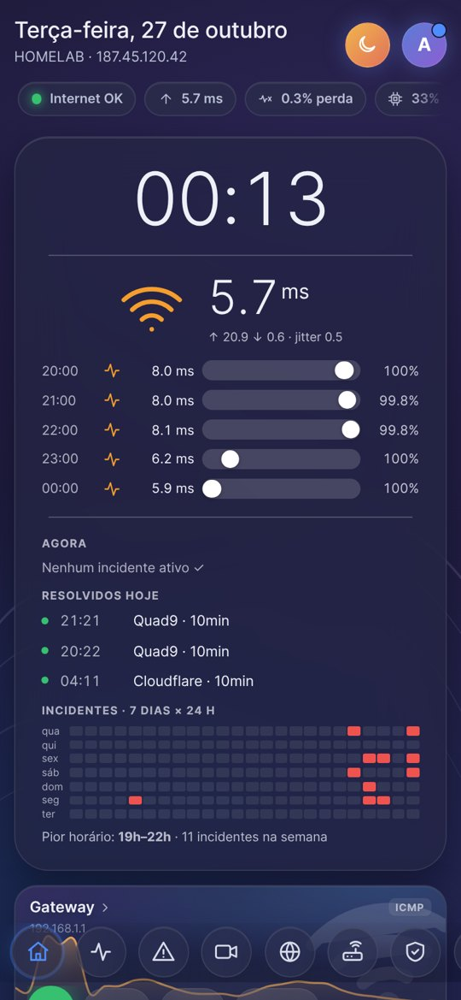</p>

---

## 📹 Câmeras (DVR Intelbras)

Integração com DVRs Intelbras da linha **MHDX** (API compatível com Dahua):

- Mosaico e tela cheia **ao vivo**, mais uma cena opcional no Modo TV
- O vídeo **só é puxado do DVR enquanto alguém está assistindo**; ao fechar a tela, o stream para
- O vídeo é repassado sem conversão pelo [go2rtc](https://github.com/AlexxIT/go2rtc) (baixado pelo `install.sh`), por isso roda até no Raspberry Pi 3
- Fotos de cada canal e alertas de **perda de vídeo** e **falha no HD**, com a última imagem no Telegram

Requisitos:
- Streams em **H.264**. Os navegadores não tocam H.265: troque em *Câmera → Codificação* no DVR.
- Um usuário do DVR só de visualização.
- Se o teste mostrar `HTTP 404` nas consultas, habilite o **CGI** nos serviços de rede do DVR. Fotos, nomes e eventos usam o CGI; o vídeo ao vivo usa só o RTSP (porta 554).

O go2rtc escuta apenas em `127.0.0.1`. O navegador nunca fala com o DVR diretamente: tudo passa pelo NetNOC, com login. A senha do DVR não é gravada no arquivo do go2rtc.

---

## 🧰 Requisitos

- Python 3.9 ou superior
- Linux (testado em Raspberry Pi OS e DietPi, inclusive no Raspberry Pi 3)
- Acesso à internet no aparelho (ping, DNS, IP público e speedtest)

---

## 🚀 Instalação

> 📘 **Tutorial completo passo a passo (serviço, HTTPS, backup, problemas comuns): [INSTALL.md](INSTALL.md)**

```bash
git clone https://github.com/ebertonjs/netlab.git
cd netlab
chmod +x install.sh
./install.sh
```

O `install.sh`:
1. instala `gcc`/`python3-dev` se faltar (para compilar o `psutil`), além de `snmp`, `traceroute` e `ping`;
2. baixa o **go2rtc** para a sua arquitetura (câmeras ao vivo);
3. cria o ambiente virtual (`venv`) e instala as dependências.

> Rode **sem** `sudo` — o script pede a senha só quando precisa instalar pacotes.

### Rodando

```bash
source venv/bin/activate
python3 -m uvicorn main:app --host 0.0.0.0 --port 8000
```

Abra `http://IP_DO_DISPOSITIVO:8000` em qualquer aparelho da rede (`hostname -I` mostra o IP do Pi).

Na primeira execução, a senha do usuário **admin** aparece no log. Também dá para defini-la antes com `NETNOC_ADMIN_PASSWORD`, ou trocar depois:

```bash
venv/bin/python manage.py set-password admin
```

### Iniciando no boot (systemd)

Jeito rápido: `./install.sh --service` cria e ativa o serviço. Ou manualmente:

```ini
# /etc/systemd/system/netnoc.service
[Unit]
Description=NetNOC
After=network-online.target
Wants=network-online.target

[Service]
WorkingDirectory=/caminho/para/netlab
ExecStart=/caminho/para/netlab/venv/bin/python3 -m uvicorn main:app --host 0.0.0.0 --port 8000
Restart=always
User=seu_usuario

[Install]
WantedBy=multi-user.target
```

```bash
sudo systemctl daemon-reload
sudo systemctl enable --now netnoc
journalctl -u netnoc -f        # logs
```

---

## ⚙️ Configuração

Tudo pela aba **Configurações**:

- **Destinos** — hosts a monitorar, com dependência (pai) e grupo para o mapa
- **Geral** — intervalos de coleta, speedtest automático e nome do painel
- **Alertas** — limites de latência, jitter, perda e DNS, e Telegram (bot + chat_id, com botão de teste)
- **Integrações** — MikroTik, AdGuard Home e DVR (com **Salvar e testar**, que mostra o que o equipamento respondeu)
- **Aparência** — tema, modo, cor, tamanho da interface e padrão do servidor
- **Backup/restauração** da configuração (as senhas não saem no arquivo)

O `config.json` só é usado na primeira execução para popular o banco; depois tudo fica no SQLite.

### Telegram

1. Crie um bot com o [@BotFather](https://t.me/BotFather) (`/newbot`) e copie o **token**.
2. Mande qualquer mensagem para o bot.
3. Abra `https://api.telegram.org/bot<TOKEN>/getUpdates` e copie o `chat_id`.
4. Cole os dois em **Configurações → Alertas**, ative e clique em **Enviar teste**.

### URLs úteis (quiosque)

| URL | O que faz |
|---|---|
| `/?skin=terminal&modo=verde#tv` | Modo TV no tema NOC Terminal |
| `/?skin=grafana&modo=dark` | Força o tema Grafana nesta tela |
| `/?skin=material&cor=%230b57d0` | Material You com outra cor |
| `/?densidade=minima` | Interface menor nesta tela |
| `/classic` | Interface antiga (v2) |

### Variáveis de ambiente

| Variável | Para que serve |
|---|---|
| `NETNOC_ADMIN_PASSWORD` | Senha inicial do `admin` |
| `NETNOC_DB` | Caminho do banco SQLite (padrão `netnoc.db`) |
| `NETNOC_KEY_FILE` | Arquivo da chave de cifragem (padrão `netnoc.key`) |
| `NETNOC_SECRET_KEY` | Chave de cifragem direto na variável (alternativa ao arquivo) |
| `NETNOC_GO2RTC` | Caminho do go2rtc, se não estiver em `bin/go2rtc` |
| `NETNOC_AUTH=off` | Desliga o login (não recomendado) |

> ⚠️ Faça backup do `netnoc.db` **e** do `netnoc.key`. Sem a chave, as senhas e tokens salvos não podem ser lidos.

### Agente para sites remotos

1. Gere o token em **Configurações → Segurança**.
2. Em cada alvo, informe o site (ex.: `filial-a`).
3. No site remoto: `python3 agent.py --url https://noc.exemplo:8000 --site filial-a --token TOKEN`

### Prometheus

`GET /metrics` com Basic ou `Authorization: Bearer <token>` (o token é gerado na interface).

---

## 🔄 Atualizando

```bash
cd netlab
git pull
./install.sh          # baixa o go2rtc e instala dependências novas
sudo systemctl restart netnoc
```

O banco migra sozinho na primeira subida (faça backup antes). No navegador, `Ctrl+F5` uma vez.

---

## 🗂️ Estrutura

```
netlab/
├── main.py        # API FastAPI + rotas do frontend
├── monitor.py     # coletores supervisionados: ping, DNS, sistema, incidentes, integrações
├── dvr.py         # DVR Intelbras: CGI, eventos, fotos e go2rtc sob demanda
├── security.py    # login, sessões, CSRF, CSP, limite de tentativas
├── db.py          # SQLite (WAL, um único escritor) e rollups 5 min / 1 h
├── stats.py · sla.py · checks.py · snmp.py · sites.py · zabbix.py · notifier.py · backup.py
├── agent.py       # agente para sites remotos
├── install.sh · manage.py · config.json · requirements.txt
├── static/
│   ├── app.html             # interface v3
│   ├── glass/               # temas, modo TV, player de câmeras, fontes locais
│   └── index.html           # interface clássica (/classic)
├── docs/          # notas de cada atualização e capturas de tela
├── INSTALL.md     # tutorial de instalação
└── CHANGELOG.md   # histórico de versões
```

---

## 🛠️ Notas técnicas

- Coletores supervisionados: uma exceção não derruba a thread, e a saúde de cada um aparece em Configurações (`/api/health/workers`)
- Janela de avaliação por tempo (`window_seconds`, padrão 300 s) e DNS lento só depois de 3 medições seguidas
- Histórico bruto de 7 dias, agregados de 5 min/1 h por mais tempo (`history_retention_days`)
- Chart.js, ícones e fontes ficam no próprio projeto: funciona sem internet e sem CDN
- Ping usa o `ping` do sistema, sem precisar de root

---

## 📄 Licença

MIT — veja [LICENSE](LICENSE).
