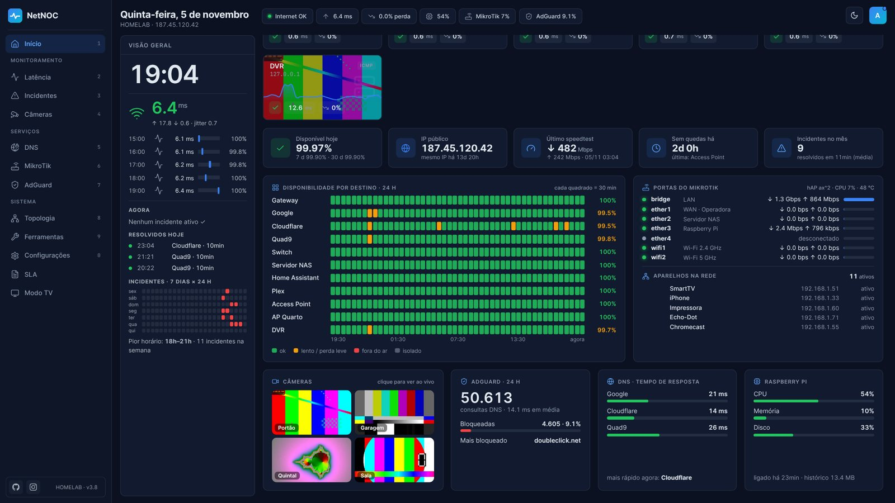
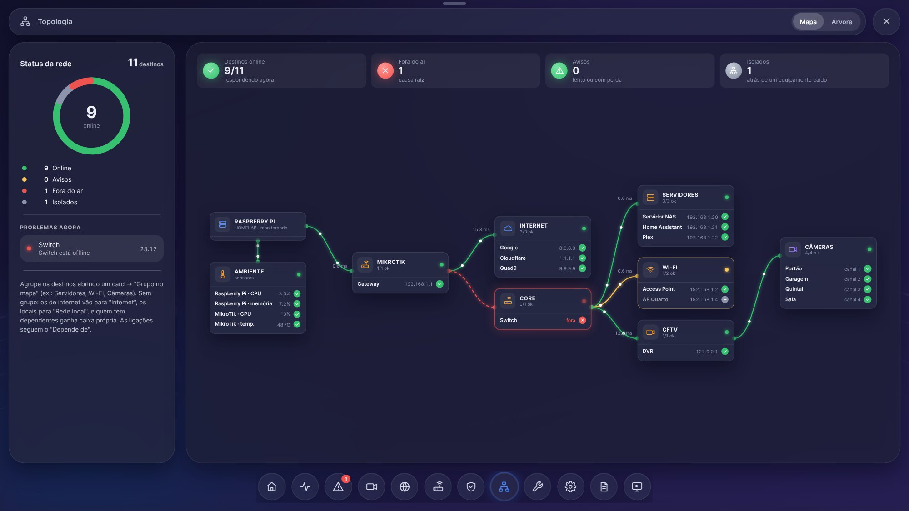
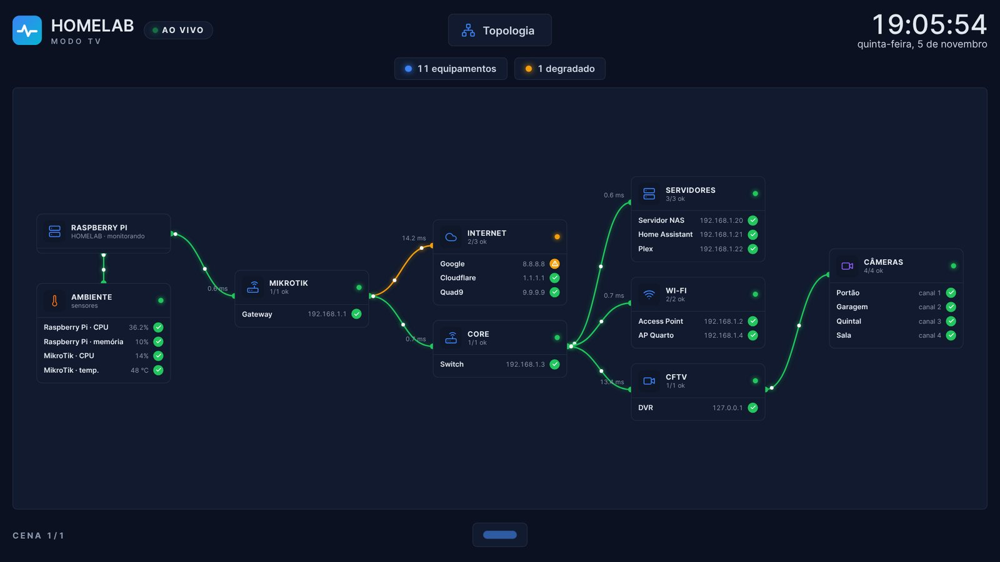
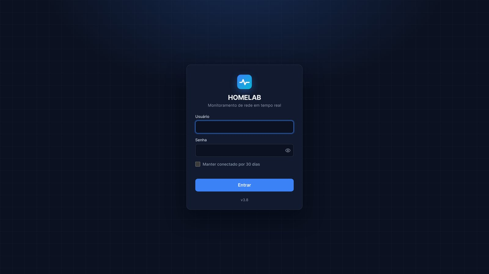

# 🛰️ NetLAB

Painel de monitoramento de rede **self-hosted** (na interface ele se chama **NetNOC**; o nome é configurável), feito para rodar num Raspberry Pi (ou qualquer Linux) e ficar aberto num tablet na parede, numa TV ou no PC. Ping, DNS, incidentes com a causa, MikroTik, AdGuard, mapa da rede, SLA, câmeras do DVR e Modo TV — tudo num processo leve, com SQLite embutido e sem depender de serviço externo. A v4.0 enxugou o projeto para o que um NOC doméstico/pequeno usa de verdade (veja o [CHANGELOG](CHANGELOG.md)).


---

## ✨ Destaques

- **Ping em tempo real** por destino — latência, jitter e perda, com sparkline e disponibilidade por hora
- Checks **ICMP, TCP e HTTP/HTTPS** (código esperado e validade do certificado)
- **Incidentes automáticos** que abrem e fecham sozinhos (offline, perda, latência, jitter, DNS lento, CPU/temperatura, câmera sem vídeo, HD do DVR). Queda local vira **um único alerta** em vez de dezenas
- **Notificações** por Telegram, Discord, webhook assinado (HMAC), e-mail e navegador, com janelas de manutenção — no Telegram, a perda de vídeo chega com a **última foto da câmera**
- **Visual Pro**: console de operações escuro, claro ou **automático** (escuro das 18h às 7h), com tamanho ajustável (Normal / Compacta / Mínima)
- **Página inicial que conta o que está acontecendo**: estado da rede e a causa no topo, 4 números ao vivo, linha do tempo só quando há problema, destinos agrupados com os que estão com problema primeiro e blocos de detalhes que cada usuário arruma
- **Mapa da rede em caixas**, estilo NOC: grupos de equipamentos ligados por linhas com pacotes animados, causa raiz em vermelho e dependentes como "isolados"
- **Diagnóstico automático da causa**: quando algo cai, o NetNOC investiga sozinho (gateway, internet, DNS, MikroTik/PPPoE/WAN, quedas simultâneas, traceroute) e diz se foi a operadora, energia, um aparelho, o DNS ou a sua rede — com evidências
- **A rede contada**: a página inicial abre com uma frase e a linha do tempo dos episódios com a causa de cada um, e o diário da rede chega todo dia no Telegram
- **Ações pelo Telegram com confirmação**, por comando ou em português pela IA: reiniciar ou desligar o PPPoE, desligar/ligar uma porta do MikroTik (com volta automática agendada no próprio roteador), reiniciar MikroTik, DVR, servidor ou "tudo", fotos das câmeras na hora, acordar um PC, bloquear um aparelho
- **Máquina do tempo**: arraste a régua do mapa e veja a rede como estava em qualquer momento dos últimos 7 dias
- **Bot no Telegram** com IA opcional (Gemini ou Groq, cota grátis): pergunte "como está o ping pro Google?" e receba o relatório
- **Modo TV** com rodízio de cenas: visão geral, mostradores, mapa da rede, equipamentos, últimas 24 h e câmeras
- **Velocidade real da internet** pelo pico de tráfego da porta WAN do MikroTik (hoje, 7 e 30 dias), sem gastar banda
- **Câmeras do DVR Intelbras** (MHDX, API compatível Dahua) **ao vivo só enquanto alguém assiste** — roda até no Raspberry Pi 3
- **Integrações**: MikroTik (REST), AdGuard Home e DVR Intelbras
- **Comparação de DNS** e ferramentas (traceroute, IPv4 × IPv6, certificados, varredura de rede)
- **SLA**, MTTR/MTBF, heatmap dia × hora, relatório imprimível, página de status pública opcional e métricas **Prometheus**
- **Login com sessão**, perfis admin/visualizador, proteção CSRF e CSP, senhas e tokens cifrados no banco (com troca de chave) e **auditoria** de toda alteração
- **Tudo configurável pela interface**, sem editar arquivo

---

## 🏠 Página inicial


1. **Estado e causa** — uma frase ("Tudo estável há 3 h" ou "Impressora fora do ar há 1 min · Causa provável: …") com **Diagnosticar agora**, **Ver no mapa** e **Incidentes**, mais 4 números: disponível hoje, latência e perda agora (ao vivo) e incidentes.
2. **O que aconteceu** — a linha do tempo com a causa de cada queda. Aberta quando há problema; com tudo bem, vira uma linha só.
3. **Destinos** — agrupados em Internet e Rede local, **com problema primeiro**.
4. **Detalhes** — disponibilidade por destino (24 h em blocos de 30 min), MikroTik (portas, **pico da WAN** e aparelhos na rede), DNS, AdGuard, servidor, câmeras e mapa de incidentes 7 dias × 24 h. Arraste ⋮⋮ para reordenar, clique no título para recolher, **Personalizar** para esconder. A arrumação fica salva por usuário, igual em qualquer aparelho. Blocos de integrações que você não usa não aparecem.



Falhas da própria coleta (o MikroTik não respondeu, por exemplo) aparecem como um aviso discreto no topo.

---

## 🗺️ Mapa da rede

**Topologia → Mapa**: os destinos viram caixas agrupadas, ligadas pelo "Depende de", com pacotes correndo nas linhas e a latência de cada ligação. Quando algo cai, a caixa e a ligação ficam vermelhas e quem depende dela aparece como **isolado** — a causa raiz salta aos olhos.


| Com um equipamento fora do ar | No Modo TV |
|---|---|
|  |  |

- **Grupos**: defina "Grupo no mapa" em cada destino (Servidores, Wi-Fi, Câmeras…). Sem grupo, o NetLAB agrupa sozinho: destinos de internet em "Internet", locais em "Rede local" e quem tem dependentes ganha caixa própria.
- Caixas extras: **Ambiente** (CPU e temperatura do servidor e do MikroTik) e **Câmeras** (canais do DVR).
- A vista antiga em árvore continua no botão **Árvore**.

---

## 🎨 Visual

Um tema só, o **Pro**: console de operações com menu lateral, superfícies planas, um azul de destaque e cores só para estado; números tabulares e IPs em monoespaçada. Ícones [Lucide](https://lucide.dev).

| Escuro | Claro |
|---|---|
|  |  |

Em **Configurações → Aparência**: modo **escuro, claro ou automático** (escuro das 18h às 7h, troca sozinho), tamanho da interface e o padrão do servidor. Cada aparelho pode ter o seu.

---

## 🔎 Diagnóstico automático

Quando um destino cai ou piora, o NetNOC não manda só "Google offline": em ~15 s ele investiga e manda a causa provável.

```
🔎 Diagnóstico · Google, Cloudflare
Causa provável: Operadora: a conexão PPPoE caiu (confiança alta)
Sua rede está normal (o gateway responde), mas a conexão pppoe-out1 está desconectada.

Evidências:
✅ Gateway 192.168.88.1: responde (0,8 ms, perda 0%)
❌ Internet (Cloudflare 1.1.1.1): sem resposta
✅ MikroTik no ar há 12d 4h · CPU 3%
❌ Conexão pppoe-out1: DESCONECTADA
✅ Porta WAN ether1: com link

O que fazer:
→ Se não voltar em alguns minutos, ligue para a operadora
```

Causas reconhecidas: operadora (PPPoE, ONU sem link, internet fora, instabilidade), falha local, MikroTik reiniciou, falta de energia no servidor, um aparelho só, equipamento do qual outros dependem, parte da rede local, serviço externo, DNS, perda dentro da rede e banda saturada. Funciona sem MikroTik (com menos evidências) e sem IA.

## 🤖 Bot no Telegram

O mesmo bot que manda os alertas também responde. Configure em **Configurações → Alertas → Bot e IA no Telegram** (o token e o Chat ID do Telegram precisam estar preenchidos; o bot só conversa com esse chat).

| Comando | O que faz |
|---|---|
| `/status` | resumo: internet, cada destino e alertas abertos |
| `/ping <destino ou IP> [n]` | ping agora, comparado com as últimas 24 h |
| `/trace <destino ou IP>` | traceroute |
| `/alertas` | incidentes abertos e das últimas 24 h |
| `/mk` | MikroTik: CPU, temperatura e tráfego das portas |
| `/diagnostico [destino]` | investiga a causa agora (rede toda ou um destino) |
| `/diario` | resumo das últimas 24 h com a causa de cada queda |
| `/banda` | quem está usando a internet agora (por aparelho) |
| `/aparelhos` · `/bloqueados` | aparelhos conectados, novos da semana e bloqueados |
| `/cameras [nome ou número]` | fotos das câmeras agora (todas viram um álbum) |
| `/portas` | portas do MikroTik com comentário, link e qual é a internet |
| `/desligar <porta ou pppoe> [min]` · `/religar <porta>` | desliga/liga uma porta (pelo nome ou comentário, ex.: "roteador") — pede confirmação; religa sozinha no tempo configurado |
| `/reiniciar mikrotik \| dvr \| servidor \| netnoc \| tudo` | reinicia, na ordem segura, e avisa quando voltar — pede confirmação |
| `/pppoe` | reinicia a conexão PPPoE — pede confirmação |
| `/acordar <PC>` | liga o computador pela rede (Wake-on-LAN) — pede confirmação |
| `/bloquear` · `/desbloquear <aparelho>` | corta ou libera o acesso do aparelho — pede confirmação |

**Ações** vêm desligadas: ative em Configurações → Alertas → Bot → "Permitir ações no roteador" e, para portas e reinícios, as chaves próprias logo abaixo (com o tempo da volta automática e o que entra no "reinicia tudo").

Proteções das portas: a internet (PPPoE/WAN) nunca fica desligada sem volta automática, que é agendada **no próprio MikroTik** (funciona mesmo sem internet e sem o Telegram); a porta em que o servidor do NetNOC está ligado e a bridge nunca são desligadas. Para o bot reiniciar o servidor e o NetNOC, rode uma vez no Pi `./install.sh --permitir-reinicio` (libera só `systemctl reboot` e `systemctl restart netnoc`; desfaça com `--remover-reinicio`). Reiniciar o DVR precisa de um usuário administrador no DVR. Cada uma chega com os botões **Sim / Cancelar** e só acontece no "Sim". O usuário do MikroTik precisa de permissão de escrita; o bloqueio usa a lista `netnoc-bloqueados` e cria uma regra "NetNOC" no topo do firewall (apague-a para desfazer tudo).

**Com IA** (opcional), dá para pedir em português: *"a internet caiu essa noite?"*, *"me manda a foto do portão"*, *"desabilita a porta do roteador por 10 min"*, *"desliga o PPPoE"*, *"reinicia tudo"*. A IA escolhe as consultas, o NetNOC executa e ela escreve a resposta. Duas opções com cota grátis:

- **Google Gemini** — chave em [aistudio.google.com/apikey](https://aistudio.google.com/apikey)
- **Groq** — chave em [console.groq.com/keys](https://console.groq.com/keys)

A IA não executa nada sozinha: as consultas são só leitura e as ações viram um pedido com os botões **Sim / Cancelar**, validado pelo servidor. Ela não altera configuração nem roda comandos livres.

## 📺 Modo TV

Tela cheia, pensada para ficar ligada o dia todo: relógio grande, rodízio automático de cenas e alerta em tela cheia quando algo crítico acontece (com som opcional).

| Visão geral | Últimas 24 horas |
|---|---|
|  |  |

**Mostradores**: um aparelho redondo por destino, no estilo termostato de parede. O anel gira com a latência e brilha em âmbar ou vermelho quando algo degrada ou cai. Só ela, fixa: `/#tv?cenas=6&tempo=0`.


Atalhos: `←` `→` trocam de cena, `espaço` pausa, `A` dispensa o alerta, `S` liga/desliga o som, `F` tela cheia, `Esc` sai.
Para abrir direto numa TV: `http://IP:8000/#tv` — ou só algumas cenas: `/#tv?cenas=1,2,5&tempo=20`.

---

## 📈 Latência, celular e login


| Celular | Login |
|---|---|
|  |  |

---

## 🦀 Coletor em Rust (opcional)

Para Raspberry Pi mais fraco: o binário **`netnoc-collector`** assume o ping (ICMP nativo, TCP e HTTP), o MikroTik e o AdGuard Home, gravando no mesmo banco. Ele usa poucos MB de RAM e não cria um processo a cada ping. O painel continua igual, e se o coletor parar, o NetNOC volta a coletar sozinho.

Compilação, instalação como serviço e teste antes × depois: [`collector/README.md`](collector/README.md).

---

## 📹 Câmeras (DVR Intelbras)

Integração com DVRs Intelbras da linha **MHDX** (API compatível com Dahua):

- Mosaico e tela cheia **ao vivo**, mais uma cena opcional no Modo TV
- O vídeo **só é puxado do DVR enquanto alguém está assistindo**; ao fechar a tela, o stream para
- O vídeo é repassado sem conversão pelo [go2rtc](https://github.com/AlexxIT/go2rtc) (baixado pelo `install.sh`), por isso roda até no Raspberry Pi 3
- Fotos de cada canal e alertas de **perda de vídeo** e **falha no HD**, com a última imagem no Telegram

Requisitos:
- Streams em **H.264**. Os navegadores não tocam H.265: troque em *Câmera → Codificação* no DVR.
- Um usuário do DVR só de visualização.
- Se o teste mostrar `HTTP 404` nas consultas, habilite o **CGI** nos serviços de rede do DVR. Fotos, nomes e eventos usam o CGI; o vídeo ao vivo usa só o RTSP (porta 554).

O go2rtc escuta apenas em `127.0.0.1`. O navegador nunca fala com o DVR diretamente: tudo passa pelo NetNOC, com login. A senha do DVR não é gravada no arquivo do go2rtc.

---

## 🧰 Requisitos

- Python 3.9 ou superior
- Linux (testado em Raspberry Pi OS e DietPi, inclusive no Raspberry Pi 3)
- Acesso à internet no aparelho (ping, DNS e IP público)

---

## 🚀 Instalação

> 📘 **Tutorial completo passo a passo (serviço, HTTPS, backup, problemas comuns): [INSTALL.md](INSTALL.md)**

```bash
git clone https://github.com/ebertonjs/netlab.git
cd netlab
chmod +x install.sh
./install.sh
```

O `install.sh`:
1. instala `gcc`/`python3-dev` se faltar (para compilar o `psutil`), além de `traceroute` e `ping`;
2. baixa o **go2rtc** para a sua arquitetura (câmeras ao vivo);
3. cria o ambiente virtual (`venv`) e instala as dependências.

> Rode **sem** `sudo` — o script pede a senha só quando precisa instalar pacotes.

### Rodando

```bash
source venv/bin/activate
python3 -m uvicorn main:app --host 0.0.0.0 --port 8000
```

Abra `http://IP_DO_DISPOSITIVO:8000` em qualquer aparelho da rede (`hostname -I` mostra o IP do Pi).

Na primeira execução, a senha do usuário **admin** aparece no log. Também dá para defini-la antes com `NETNOC_ADMIN_PASSWORD`, ou trocar depois:

```bash
venv/bin/python manage.py set-password admin
```

Outros comandos do `manage.py`: `secrets` (senhas e tokens salvos e se estão cifrados), `protect` (cifra o que estiver em texto puro), `rotate-key --yes` (chave nova, com o NetNOC e o coletor parados) e `audit 50` (últimas linhas da auditoria).

### Iniciando no boot (systemd)

Jeito rápido: `./install.sh --service` cria e ativa o serviço. Ou manualmente:

```ini
# /etc/systemd/system/netnoc.service
[Unit]
Description=NetNOC
After=network-online.target
Wants=network-online.target

[Service]
WorkingDirectory=/caminho/para/netlab
ExecStart=/caminho/para/netlab/venv/bin/python3 -m uvicorn main:app --host 0.0.0.0 --port 8000
Restart=always
User=seu_usuario

[Install]
WantedBy=multi-user.target
```

```bash
sudo systemctl daemon-reload
sudo systemctl enable --now netnoc
journalctl -u netnoc -f        # logs
```

---

## ⚙️ Configuração

Tudo pela aba **Configurações**:

- **Geral** — intervalos de coleta, dados (histórico), **backup/restauração** (as senhas não saem no arquivo), nome do painel e página de status pública
- **Aparência** — modo (escuro, claro, automático), tamanho da interface e padrão do servidor
- **Destinos** — hosts a monitorar, com dependência (pai) e grupo para o mapa
- **Alertas** — Telegram, bot e IA, manutenção e **outros canais** (Discord, webhook assinado, e-mail)
- **Integrações** — MikroTik (com a **porta da internet** para o pico da WAN), AdGuard Home e DVR
- **Segurança** — senhas e tokens salvos, **usuários**, token do Prometheus e **auditoria** com filtros

O `config.json` só é usado na primeira execução para popular o banco; depois tudo fica no SQLite.

### Telegram

1. Crie um bot com o [@BotFather](https://t.me/BotFather) (`/newbot`) e copie o **token**.
2. Mande qualquer mensagem para o bot.
3. Abra `https://api.telegram.org/bot<TOKEN>/getUpdates` e copie o `chat_id`.
4. Cole os dois em **Configurações → Alertas**, ative e clique em **Enviar teste**.

### URLs úteis (quiosque)

| URL | O que faz |
|---|---|
| `/?modo=light` · `/?modo=dark` · `/?modo=auto` | Fixa o modo nesta tela |
| `/?densidade=minima` | Interface menor nesta tela |
| `/#tv` · `/#tv?cenas=1,2,6&tempo=20` | Modo TV (todas ou algumas cenas) |
| `/status` | Página de status pública (se ativada) |

### Variáveis de ambiente

| Variável | Para que serve |
|---|---|
| `NETNOC_ADMIN_PASSWORD` | Senha inicial do `admin` |
| `NETNOC_DB` | Caminho do banco de configuração (padrão `netnoc.db`) |
| `NETNOC_HIST_DB` | Caminho do banco de histórico (padrão `netnoc-historico.db`, na mesma pasta) |
| `NETNOC_KEY_FILE` | Arquivo da chave de cifragem (padrão `netnoc.key`) |
| `NETNOC_SECRET_KEY` | Chave de cifragem direto na variável (alternativa ao arquivo) |
| `NETNOC_GO2RTC` | Caminho do go2rtc, se não estiver em `bin/go2rtc` |
| `NETNOC_AUTH=off` | Desliga o login (não recomendado) |

> ⚠️ Faça backup do `netnoc.db` **e** do `netnoc.key`. Sem a chave, as senhas e tokens salvos não podem ser lidos.

### Configuração × histórico

| Arquivo | O que guarda | Pode apagar? |
|---|---|---|
| `netnoc.db` | destinos, grupos, integrações, usuários, aparelhos do DHCP | **Não** — é a sua configuração (alguns KB) |
| `netnoc-historico.db` | pings, médias, DNS, tráfego do MikroTik, incidentes, eventos, logs | **Sim**, quando quiser |

Para zerar o histórico: **Configurações → Geral → Dados → Apagar histórico**, ou com o serviço parado `rm netnoc-historico.db*` (ele é recriado vazio na próxima subida).

### Prometheus

`GET /metrics` com Basic ou `Authorization: Bearer <token>` (gere o token em **Configurações → Segurança**).

---

## 🔄 Atualizando

```bash
cd netlab
git pull
./install.sh          # baixa o go2rtc e instala dependências novas
sudo systemctl restart netnoc
```

O banco migra sozinho na primeira subida (faça backup antes). No navegador, `Ctrl+F5` uma vez.

**Da v3 para a v4.0**: a migração apaga do banco o que saiu (SNMP, Zabbix, multi-site e speedtest) e tira da lista os destinos do tipo agente; o resto da configuração fica. Temas antigos viram o Pro (mantendo claro/escuro).

Para uma instalação limpa sem perder nada: `./reinstalar.sh` faz backup da configuração, chave e histórico, remove, instala a versão atual e restaura os dados (detalhes no [INSTALL.md](INSTALL.md#13-reinstalar-ou-desinstalar-com-backup-automático)).

---

## 🗂️ Estrutura

O código fica no pacote `netnoc/`, **um módulo por pasta**, cada uma com um README que explica o que faz, o histórico de mudanças e as próximas melhorias.

```
netlab/
├── main.py                 # ponto de entrada (o serviço continua com: uvicorn main:app)
├── netnoc/
│   ├── nucleo/             # banco (SQLite), segurança e senhas cifradas, estatísticas, backup
│   ├── coleta/             # ping/TCP/HTTP, incidentes, DNS, sistema, MikroTik (pico da WAN), AdGuard
│   ├── analise/            # diagnóstico da causa, a rede contada + diário, máquina do tempo, SLA
│   ├── alertas/            # Telegram, Discord, webhook, e-mail, manutenção
│   ├── bot/                # bot do Telegram, IA (Gemini/Groq), ações com confirmação
│   ├── integracoes/        # DVR/câmeras (go2rtc)
│   └── web/                # API FastAPI e páginas
├── static/                 # interface (app.html + glass/: tema Pro, Modo TV, mapa, mostradores)
├── collector/              # netnoc-collector em Rust (opcional): ping, MikroTik, AdGuard
├── manage.py               # utilitário: reset-admin, set-password, secrets, protect, rotate-key, audit
├── install.sh · reinstalar.sh · config.json · requirements.txt
├── docs/ · INSTALL.md · CHANGELOG.md
└── LICENSE · THIRD-PARTY-NOTICES.txt
```

| Módulo | Para que serve |
|---|---|
| [`netnoc/nucleo`](netnoc/nucleo/README.md) | onde os dados ficam e quem pode entrar |
| [`netnoc/coleta`](netnoc/coleta/README.md) | mede a rede e decide quando algo virou problema |
| [`netnoc/analise`](netnoc/analise/README.md) | por que caiu, o que aconteceu, como estava |
| [`netnoc/alertas`](netnoc/alertas/README.md) | para onde vão os avisos |
| [`netnoc/bot`](netnoc/bot/README.md) | conversa e age pelo Telegram |
| [`netnoc/integracoes`](netnoc/integracoes/README.md) | câmeras do DVR |
| [`netnoc/web`](netnoc/web/README.md) | a API e as páginas |
| [`static`](static/README.md) | a interface |
| [`collector`](collector/README.md) | coletor em Rust |

## 🛠️ Notas técnicas

- Coletores supervisionados: uma exceção não derruba a thread, e a saúde de cada um aparece em Configurações (os que não têm nada configurado nem aparecem)
- Janela de avaliação por tempo (`window_seconds`, padrão 300 s) e DNS lento só depois de 3 medições seguidas
- Histórico bruto de 7 dias, agregados de 5 min/1 h por mais tempo (`history_retention_days`)
- Chart.js, ícones e fontes ficam no próprio projeto: funciona sem internet e sem CDN
- Ping usa o `ping` do sistema, sem precisar de root

---

## 📄 Licença

**Uso gratuito, todos os direitos reservados.** Você pode baixar e usar o NetLAB de graça na sua casa, no trabalho e nas suas redes. Sem autorização por escrito, não é permitido copiar ou reaproveitar o código, redistribuir ou vender o programa, publicar versões modificadas, nem trocar o nome ou o autor. Detalhes em [LICENSE](LICENSE).

O NetLAB usa componentes de código aberto, que mantêm as próprias licenças: veja [THIRD-PARTY-NOTICES.txt](THIRD-PARTY-NOTICES.txt).
